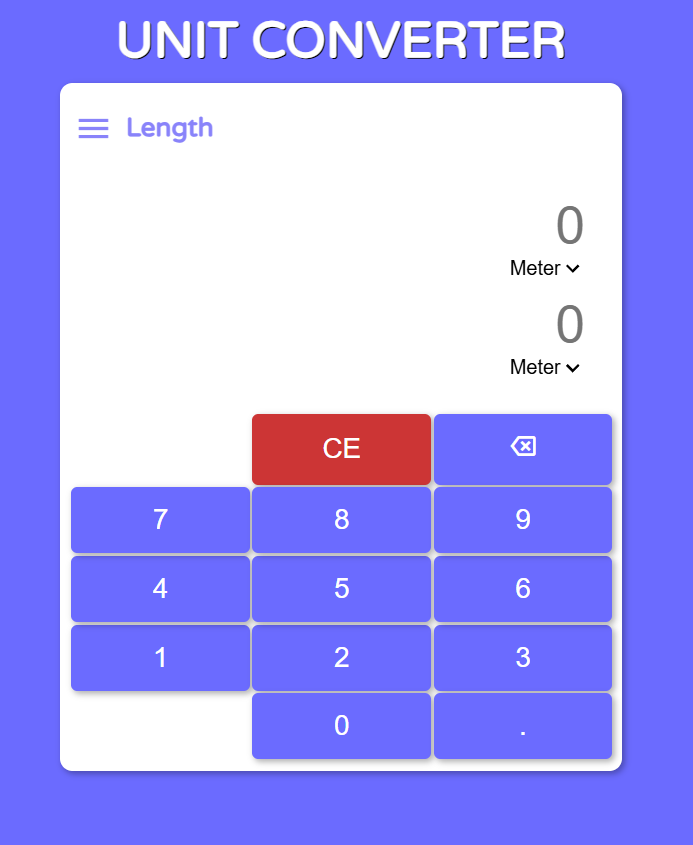

# Unit Converter

A simple, fast unit converter built with **HTML, CSS and vanilla JavaScript**. Type a value in either box and the other one updates instantly. You can use the on-screen keypad or your keyboard.

<p align="center">
  
</p>

**Live demo:** [your-username.github.io/your-repo](https://your-username.github.io/your-repo)
<!-- Replace with your GitHub Pages / hosted link, or delete this line -->

---

## Features

- **Two-way conversion**: edit either input and the other updates automatically
- **Instant updates**: changing a unit in either dropdown recalculates right away
- **On-screen keypad** with digits, decimal point, backspace and clear
- **Keyboard support**: type directly into the inputs
- **Smart decimal handling**
  - Only one dot is allowed per number
  - Pressing the dot on an empty input gives `0.`
  - Typing a leading `.` becomes `0.`
- **Input cleaning**: letters and symbols are stripped as you type
- **Clean output**: results are rounded to a maximum of 8 decimal places, with no thousand separators
- **Focus stays put**: clicking anywhere outside the inputs keeps the cursor in the last active input, so the keypad always knows where to type

## Supported Units

### Length

| Metric | Imperial |
| ------ | -------- |
| millimeter (mm) | inch |
| centimeter (cm) | foot |
| meter (m) | yard |
| kilometer (km) | mile |

### Weight

| Metric | Imperial |
| ------ | -------- |
| milligram (mg) | ounce (oz) |
| gram (g) | pound (lb) |
| kilogram (kg) | stone |
| | ton (US short ton) |

> **Note:** Weight conversion factors are defined in the code, but the converter UI currently runs length conversion only. Weight support is on the roadmap below.

## How It Works

Every unit stores its value relative to a **base unit** (meter for length, kilogram for weight).

To convert from unit A to unit B:

1. Convert the input to the base unit: `base = value × factor[A]`
2. Convert the base unit to the target: `result = base / factor[B]`

For example, converting 5 miles to kilometers:

```
base   = 5 × 1609.344 = 8046.72 m
result = 8046.72 / 1000 = 8.04672 km
```

This means you only need one factor per unit, instead of a separate formula for every pair of units.

## Getting Started

No build tools or dependencies are needed.

```bash
# 1. Clone the repository
git clone https://github.com/your-username/your-repo.git

# 2. Open the project folder
cd your-repo

# 3. Open index.html in your browser
```

You can also use a local server such as the VS Code **Live Server** extension.

## Project Structure

```
.
├── index.html     # Page layout, inputs, dropdowns and keypad
├── style.css      # Styling
├── script.js      # Conversion logic and event handling
└── README.md
```
<!-- Update file names to match your project -->

## Usage

1. Choose a unit in each dropdown (for example, **meter** and **foot**).
2. Type a number using the keypad or your keyboard.
3. The other box shows the converted value instantly.
4. Use **⌫** to delete the last digit and **CE** to clear everything.

## Roadmap

- [ ] Wire up weight conversion
- [ ] Add a category switcher (Length / Weight / Temperature / etc.)
- [ ] Add a swap-units button
- [ ] Support negative numbers
- [ ] Improve mobile layout

## Contributing

Contributions are welcome!

1. Fork the repository
2. Create a branch: `git checkout -b feature/your-feature`
3. Commit your changes: `git commit -m "Add your feature"`
4. Push to the branch: `git push origin feature/your-feature`
5. Open a pull request

## License

This project is licensed under the [MIT License](./LICENSE).
<!-- Add a LICENSE file, or change this section to match your license -->

## Author

Made by [your-name](https://github.com/your-username)
